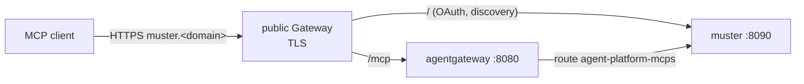

# Authentication flow

How a request authenticates against the Agent Platform. Every person signs in at one OIDC provider (Dex, `global.identity`); muster is the OAuth resource server and authorization server for MCP clients; agentgateway verifies tokens at the edge only on the routes listed in [4](#4-edge-jwt-validation-and-jwks). Install and registration steps are in [install.md](install.md); every value is in [reference.md](reference.md).

Multiple muster replicas require the shared OAuth encryption key to seal URL-elicitation continuation state. The platform enables `muster.muster.oauth.server.encryptionKey` by default for multiple replicas, using the existing `oauth-encryption-key` Secret input. An explicit setting remains the installation's choice and is checked by muster's chart. The single-replica lab example disables OAuth and needs no shared key. The muster version floor is unchanged.

## 1. The request path

A client is given one URL: **`https://muster.<domain>/mcp`** (`ingress.hostnames` overrides the hostname). Behind it, the agentgateway data plane sits in front of muster. Two routes share the hostname, split by Gateway API path specificity (`/mcp` beats `/`):

- **`/mcp`** goes to the agentgateway data plane (`:8080`). On the data plane, the hostname-less route `agent-platform-mcps` sends it to the `AgentgatewayBackend` of the same name, which is muster's `/mcp` (`agent-platform-mcps.agentgateway.musterUrl`). The agent-platform-mcps component renders both (`components.agent-platform-mcps.enabled: true`, with `agent-platform-mcps.agentgateway.viaMuster: true`, the default). Without the component the data plane has no route to muster.
- **Every other path** (`/.well-known/*`, `/oauth/*`, registration) goes straight to muster.



With the chart-owned edge (`gatewayApi.gateway.create: true`) the agentgateway data plane *is* the public Gateway, and the separate `/mcp` route is not rendered: muster's hostname-specific route serves `/mcp` too. The client URL is the same.

muster validates every token itself. agentgateway on the MCP path passes the bearer through unverified.

`muster.muster.oauth.server.trustedAudiences` is a compatibility exception to the [MCP authorization specification](https://modelcontextprotocol.io/specification/2025-06-18/basic/authorization#token-handling), which requires a token issued for the MCP server itself. muster accepts a signed ID token of the configured identity provider as a bearer when its audience is a listed client, on `/mcp` and on its person-only endpoints such as `/session-bindings`; a token naming an acting party (`act`) or bound to a DPoP key (`cnf`) is not accepted this way. muster's own access tokens from its login flow are the conforming path. List only the client IDs whose ID tokens reach muster as bearers: the portal's client and the clients whose tokens agentgateway and agent-manager forward. Removing the exception is tracked in [giantswarm/mcp-oauth#690](https://github.com/giantswarm/mcp-oauth/issues/690). The ATS smoke test checks that a listed audience is accepted and that an unlisted audience, an invalid signature and an unknown access token are refused.

## 2. OAuth discovery

All of it happens on muster's hostname:

1. `GET /mcp` without a token returns `401` with `WWW-Authenticate: Bearer resource_metadata=…/.well-known/oauth-protected-resource`.
2. The protected-resource metadata names muster as the authorization server; `/.well-known/oauth-authorization-server` gives its registration and token endpoints.
3. The client registers (gated: [install.md §5](install.md#5-after-the-install)), signs the person in at Dex through `https://muster.<domain>/oauth/callback`, and retries `/mcp` with the token.

A Gateway that rewrites error responses can strip `WWW-Authenticate`, and clients then cannot find the authorization server. On Envoy Gateway, `ingress.backendTrafficPolicy.enabled: true` renders route-scoped `BackendTrafficPolicy` objects that keep the header and lift the request timeout for streams (`timeout: "0s"`). It is off by default. It covers muster's route, and the `/mcp` route when that route is rendered.

## 3. Token handling at muster

muster aggregates many MCP servers behind `/mcp`. Each server entry in `agent-platform-mcps.mcpServers` declares how muster obtains the token it sends there (the [agent-platform-mcps](https://github.com/giantswarm/agent-platform-mcps) values: `auth`, `identityProviders`):

| `auth.mode` | When | Mechanism |
|---|---|---|
| `forward` | The server trusts the issuer the caller signed in with (typically the same cluster). | The person's bearer goes through unchanged. |
| `exchange` | The server sits behind a different issuer (another cluster's Dex). | muster performs an [RFC 8693](https://www.rfc-editor.org/rfc/rfc8693) token exchange at that issuer's token endpoint, with the client credentials of the `identityProviders.<provider>` entry. |

muster signs no tokens of its own: every downstream server validates against Dex. A kagent agent acts as the person who started its Session: agent-manager binds the Session's Actor to that person at muster, and the egress gateway puts the Actor's JWT on every call to muster, which serves it as the bound person. The runtime never holds or forwards the person's token: the Harness sets no `KAGENT_PROPAGATE_TOKEN`, so no MCP server receives it, and muster refuses a Session nobody bound. model-manager, agent-manager, cluster-manager and mcp-kubernetes receive the person's token with the audience `dex-k8s-authenticator` and act on the cluster with that person's RBAC (install.md, [The identity provider](install.md#the-identity-provider)).

## 4. Edge JWT validation and JWKS

agentgateway verifies the JWT itself (`Strict`, against `global.identity.issuerUrl`) on three routes: the kagent controller route ([5](#5-the-kagent-controller-route)), the agent-manager route (`agentManager.route` with its `jwtAuthentication.enabled`, both off by default) and the models Gateway ([6](#6-the-models-gateway)). Each takes its key set from its own `jwtAuthentication.jwks` (`host`, `port`, `path`, `tls`). The agentgateway controller fetches it and pushes the keys to the data plane. A failed fetch refuses every caller with `401 token uses the unknown key`.

An in-cluster issuer (for example Dex on `:5556` in another namespace) needs `gateway.jwksEgress.enabled: true` with that `namespace` and `port`; the render fails when a route names an in-cluster JWKS host the egress rule does not open. An external issuer on 443 needs no rule.

## 5. The kagent controller route

`kagent.controllerRoute.enabled` (off by default; rendered with `components.kagent` on) exposes the kagent controller's API: the kagent API v2 gRPC services and A2A v1, native gRPC or gRPC-Web, and A2A over HTTP under `/agents/` (JSON-RPC at `/agents/<namespace>/<name>`, the agent card at `/agents/<namespace>/<name>/.well-known/agent-card.json`). The agent cards advertise `https://<controller route hostname>`, which the chart sets as `kagent.controller.a2aGatewayUrl` unless you set your own. External requests reach it through two authentication boundaries:

- **agentgateway** (`GRPCRoute kagent-controller`, `kagent-controller-public`, `HTTPRoute kagent-a2a`, `kagent-a2a-public`), with `AgentgatewayPolicy kagent-controller-jwt` and `kagent-a2a-jwt`. JWT validation is on by default (`kagent.controllerRoute.jwtAuthentication`). A token is required and must carry the identity claim, `kagent.controller.auth.userIdClaim` (`email`). The policy **sets** `x-user-id` from the verified claim, which replaces any value the client sent, **removes** `x-agent-name` and `x-user-groups`, and passes the bearer through.
- **the kagent UI** (`kagent.uiRoute` behind `kagent.oauth2-proxy`). Its route removes `x-user-id`, `x-agent-name` and `x-user-groups`, and the bearer comes from the oauth2-proxy session.

In `kagent.controller.auth.mode: trusted-proxy`, the controller verifies a person's bearer signature, exact issuer, expiry and trusted audience before taking the caller from its `email` claim. The native controller receives `controller.auth.issuer`, `jwksURL` and `audiences`; the extensions controller receives the equivalent issuer configuration through `KAGENT_EXTENSIONS_OIDC_ISSUERS`. Its API port (`:8083`) admits only the kagent UI, the agentgateway data plane, Substrate's egress gateway and, with workspaces on, workspace-manager.

With `kagent.controller.authorization.mode: kubernetes` (the default from kagent 1.19), the controller then asks the API server, with a SubjectAccessReview for that user and the token's `groups`, whether the caller may see and run an agent. A person needs `agent-platform:user`, `agent-platform:editor` or `agent-platform:admin` in the agent's namespace; in the kagent namespace, `tenants.platform.users` grants `agent-platform:user`. `mode: noop` lets every signed-in caller see and run every agent. See [UPGRADE.md](../UPGRADE.md).

| Request | At the gateway |
|---|---|
| no token, foreign issuer, wrong audience, expired or bad signature | `401` |
| valid token without the identity claim | `403` |
| valid token | passed through, `x-user-id` = the claim, `x-agent-name` and `x-user-groups` removed |

`x-agent-name` and `x-user-groups` are the controller's agent-call headers: only an agent's runtime sends them, from inside the cluster and never through these routes. The identity contract through the routes is `x-user-id` alone. The same policy covers the in-cluster `kagent-mcp` route.

The controller requires a trusted audience. Set `kagent.controller.auth.audiences` explicitly, or let the meta chart use `kagent.controllerRoute.jwtAuthentication.audiences`. With neither list set and the UI off, it derives the platform's login client ID for the same issuer. Enabling the UI requires an explicit list that includes its login client and the other trusted clients. The derived list reaches the native controller, the extensions controller's `KAGENT_EXTENSIONS_OIDC_ISSUERS` and the route's JWT providers; an explicit extensions environment entry remains the operator's configuration.

For the native kagent upstream, the A2A exchange must request audiences accepted by both the controller and its route. This check keeps an external client's token from being exchanged successfully into a token that the next authenticated hop rejects. An explicit remote `klausGateway.a2a.url` keeps that upstream's own authentication contract.

Before turning the route on, set `kagent.controllerRoute.parentRef` (its default names a Giant Swarm Gateway; clear `name` to fall back to the chart-owned edge or `global.gatewayApi.parentRefs`) and `kagent.controllerRoute.jwtAuthentication.jwks` with `gateway.jwksEgress` for your issuer ([4](#4-edge-jwt-validation-and-jwks)).

Reaching the controller:

| From | Target | Transport |
|---|---|---|
| the portal backend, a CLI | `https://agentgateway.<domain>` (`kagent.controllerRoute.hostname`; the portal's `apiBaseUrl`) | gRPC over HTTP/2, or gRPC-Web |
| klaus-gateway and other in-cluster clients | `grpc://agentgateway.<release namespace>.svc.cluster.local:8080` (the `klausGateway.a2a.url` default) | plaintext HTTP/2 (h2c) |

`kagent.controllerRoute.jwtAuthentication.enabled: false` removes the policy, and the controller then trusts `x-user-id` as sent. Use it only for local development.

## 6. The models Gateway

A model served by the serving slice ([reference](reference.md#the-serving-slice-and-the-models-gateway)) is reached through its own Gateway, `models.<domain>` (`modelServing.modelsGateway.hostPrefix` + `global.domain`). It is never reached through muster. One `AgentgatewayPolicy`, `models-jwt`, sits on the Gateway itself with `Strict` validation and `strategy.inheritance: Override`, so no model route can weaken it:

- **Issuer**: `global.identity.issuerUrl`. The JWKS comes from `modelServing.modelsGateway.jwtAuthentication.jwks` (port 443 by default).
- **Audience**: `dex-k8s-authenticator` only (`jwtAuthentication.audiences`), the login client whose ID token a person holds.
- **Outcome**: `200` with a valid token. `401` without one, or with an expired, foreign-issuer or wrong-audience token, before the request reaches the model. The verified `Authorization` header is stripped before the request reaches the model server.

```text
POST https://models.<domain>/<namespace>/<model>/v1/chat/completions
Authorization: Bearer <id_token>
```

## 7. klaus-gateway's A2A server

Outside A2A clients, such as an application's backend, reach agents through klaus-gateway's A2A server. Its entry is `klausGateway.agentgatewayRoute.a2aServer`, off by default, on its own hostname (`hostname`, else `klausGateway.agentgatewayRoute.hostname`). agentgateway checks the client's token and exchanges it at the installation's Dex. klaus-gateway receives only the Dex token, checks it again, and starts each Session through agent-manager as the caller ([klaus-gateway's `docs/a2a-server.md`](https://github.com/giantswarm/klaus-gateway/blob/main/docs/a2a-server.md)).

| Path | Route | Policy |
|---|---|---|
| `/.well-known/agent-card.json` | `klausgateway-a2a-card` | None: a client reads the card before it has a token |
| `/a2a` | `klausgateway-a2a` | `AgentgatewayPolicy` `klausgateway-a2a` |

JSON-RPC calls use the A2A backend `klausgateway-a2a`, so agentgateway records A2A protocol metrics and the JSON-RPC method in logs and traces. Card GETs use the static backend `klausgateway-a2a-cards`: klaus-gateway already advertises its configured public URLs, and a static backend preserves error responses such as 404. The per-agent GET rule remains on the authenticated `/a2a` route and receives the same JWT validation, client authorization and token exchange as POST requests.

The `klausgateway-a2a` policy does the following:

- **Token check.** JWT validation is `Strict`, with one provider per entry of `issuers`. Each provider has the issuer's exact `audience` and its own JWKS backend (`klausgateway-a2a-jwks-<index>`). A token of any other issuer gets `401`.
- **Client check.** One `Require` rule checks that the client that requested the token is in that issuer's `allowedClients`. The client is the token's `azp`, else its `client_id`, else its only `aud`. Dex does not check the subject token's audience in an exchange (dexidp/dex#4397), so this check and the audience check above are the only ones.
- **Bearer profile.** The entry accepts ordinary bearer JWTs without `cnf` or `act` claims. Its authorization rule rejects these claims before exchange because the Dex ID-token conversion does not preserve proof-of-possession constraints or an actor chain. Supporting bound or delegated tokens requires an exchange and downstream verifier that enforce those constraints.
- **Exchange.** An RFC 8693 token exchange at Dex's token endpoint, as the Dex client `exchange.clientId`, with `ClientSecretBasic` and the Secret `exchange.secretName`.
  - The endpoint is the `AgentgatewayBackend` `klausgateway-a2a-dex-token`, from `exchange.endpoint` (`host`, `port`, `path`, `tls`, the same shape as an issuer's `jwks`). It is always TLS, verified against `exchange.endpoint.tls.caSecretName`, else `global.identity.ca.secretName`, else the system trust, so a Dex with a private CA works.
  - With `exchange.endpoint.host` empty, the endpoint is `<global.identity.issuerUrl>/token` on the issuer's host and port.
  - An in-cluster host (`<service>.<namespace>.svc.cluster.local`) also opens the data plane's egress to that namespace and port.
  - `connector_id` is the `connectorId` of the token's issuer.
  - Every audience in `exchange.audiences` is requested as Dex's `audience:server:client_id:<aud>` scope.
  - The requested token type is an ID token.
  - The exchanged token replaces the client's token, so klaus-gateway never sees the client's token.
- **No exchange cache.** The agent runtime keeps the exchanged token for a whole turn, so klaus-gateway refuses one with less than `a2aServer.minTokenLifetime` (25 minutes) left. agentgateway's cache serves an entry until 15 seconds before it expires and cannot require a minimum lifetime, so every request is exchanged.
- **One token type.** agentgateway sends one `subject_token_type` per policy (`exchange.subjectTokenType`), so every issuer must send the same token type.

The meta chart derives the klaus-gateway release's `a2aServer` block from the same entry: `publicUrl`, the issuers' card schemes, and the platform token's issuer, JWKS URL, audience (the first of `exchange.audiences`) and client (`exchange.clientId`). It enables the A2A client and derives its target from the platform's agentgateway Service, including its name and namespace. Enable `components.kagent` and configure `kagent.controllerRoute.enabled`, or provide an explicit `klausGateway.a2a.url` for another authenticated upstream. An own `klausGateway.a2aServer` value that differs fails the render. This needs the floor of `components.klaus-gateway.versionRange` at 4.20.0-rc.6 or later, compared with its full prerelease; earlier release candidates lack part of the entry behavior. A branch build of klaus-gateway (`X.Y.Z-r<hash>t<time>h<sha>`) carries the last release's version, so for it nothing is derived and the render does not fail: set `klausGateway.a2aServer` by hand.

Session creation calls agent-manager through the selected muster, including when the A2A gRPC upstream is remote. With the platform's muster, enable `components.agent-manager` and its MCP registration, or set `klausGateway.a2a.agentManagerToolsPrefix` for an existing registration managed outside this chart. The managed prefix follows agent-manager's configured MCPServer name.

The exchange must request audiences for the active muster visibility checks and caller-identity Kubernetes calls. The Giant Swarm API audience is `dex-k8s-authenticator` by default. `global.identity.kubernetes.audiences` supplies the API trust set and its first entry fills muster's native `muster.muster.writesAsCaller.kubernetesAudience` unless that setting is explicit. Custom audience strings must match registered Dex client IDs and the API server's configuration; `kubernetes` is a local client ID only when an installation configures it that way.

With network policies on, the data plane gets egress to klaus-gateway on 8080 and to the configured token endpoint. The agentgateway controller gets egress to every external JWKS host the issuers name. Independently of Slack OBO, klaus-gateway receives egress for its own Dex JWKS fetch, muster Session-start calls, Kubernetes organization lookup and the agentgateway gRPC client. Private external addresses on vanilla Kubernetes use `gateway.jwksEgress.external.cidrs`; Cilium policies select the configured hostnames and ports.

An explicit `klausGateway.a2a.url` outside the platform's agentgateway Service needs an installation network policy permitting that upstream.

Private identity providers retain TLS verification. The meta chart derives `a2aServer.caSecret` and `caSecretKey` from `global.identity.ca` unless the gateway has its own CA configuration. JWKS and token-exchange TLS references also preserve the inherited `global.identity.ca.key`. An explicit endpoint `tls.caSecretName` uses `ca.crt` unless `tls.caSecretKey` selects another key. Each Secret must exist in the consuming component's namespace.

If the Go gateway's configured JWKS host resolves to a private address, list that exact host in `klausGateway.a2aServer.token.allowPrivateIpJwksHosts`. This opt-in remains required when the request uses an HTTP proxy.

With vanilla Kubernetes network policies, enabling this entry requires `networkPolicy.kubernetes.apiServerCIDR` to name the installation's API-server address range explicitly. An unrestricted `0.0.0.0/0` or `::/0` would make its API allowance permit every destination, so the render refuses it. Cilium uses its `kube-apiserver` entity.

For an installation HTTP proxy, set the native agentgateway tunnel on `exchange.endpoint.tunnel` and on each external issuer's `jwks.tunnel`, for example `{url: "http://proxy.proxy-system.svc.cluster.local:3128", mode: Connect}`. These objects render directly as `AgentgatewayBackend.spec.policies.tunnel`; target TLS and its CA remain configured separately. Omit the tunnel for destinations in the installation's `NO_PROXY` list. agentgateway does not read `HTTPS_PROXY`; the Go gateway's JWKS client continues to honor `HTTPS_PROXY` and `NO_PROXY`. The network policies allow explicitly named tunnel URLs, including for the Go gateway when its injected `HTTPS_PROXY` uses the same proxy. A different injected proxy, a short proxy hostname or a tunnel named by `backendRef` needs an installation policy permitting its destination; rendering cannot resolve those addresses.

Dex needs the setup that klaus-gateway's `docs/a2a-server.md` lists under "Identity provider configuration":

- the exchange client, listed in `trustedPeers` of every client in `exchange.audiences`
- one connector per issuer, limited to the token exchange grant
- `allowedConnectors` on every other client
- `expiry.idTokens` longer than `a2aServer.minTokenLifetime`

## OAuth issuer connectivity

The agent-manager, vm-manager, cluster-manager, skill-manager and workspace-manager defaults set `oauth.dex.allowPrivateURLs: false`. The model-manager block does not set `oauth.dex.allowPrivateURLs`, and the mcp-kubernetes block does not set `mcpKubernetes.oauth.allowPrivateURLs`: neither value has an effect. Their Dex discovery client can reach an operator-configured issuer that resolves to a private address without this opt-in and follows `HTTP_PROXY`, `HTTPS_PROXY` and `NO_PROXY`. An issuer discovery failure calls for checking DNS, egress, proxy settings and certificate trust, rather than asking the person to sign in again. Keep HTTPS, certificate verification and the exact configured issuer identity intact; configure the installation's internal CA through `global.identity.ca.secretName` when needed.

When a manager refuses `--allow-private-oauth-urls=true` or its chart value `oauth.dex.allowPrivateURLs: true`, remove the old opt-in or set the chart value to `false`. The platform defaults already use `false`. workspace-manager needs 0.15.9 or later and mcp-kubernetes 1.14.26 or later for that: their earlier releases still need the opt-in to reach a private issuer. The component ranges require builds on mcp-oauth v1.15.0 or later. The managers and mcp-kubernetes also fetch their own Dex's key set from a private address without a setting, to validate forwarded ID tokens, so the platform no longer sets `oauth.sso.allowPrivateIPs`. That setting is deprecated: it lifts the check for every key set host and logs a warning. Do not set it to repair discovery or a certificate error.

Muster fetches its own Dex's key set from a private address without a setting too. `muster.muster.oauth.server.dex.allowPrivateIPJWKS` and its older spelling `dex.allowPrivateIPOIDC` are deprecated and log a warning; set one only for a Dex on a loopback or link-local address. Dex discovery, token and userinfo calls need neither switch. These settings do not make ID-token forwarding an MCP authorization mechanism.
